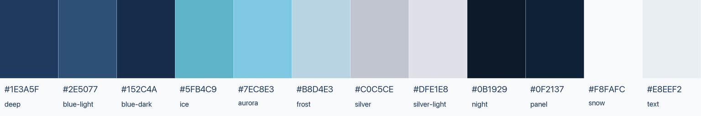

# Alopex DB brand assets

Everything in this directory is generated. Do not hand-edit a PNG here.

```bash
python3 scripts/render_brand_book.py    # draws design-book.png + manifest.json
python3 scripts/export_brand_assets.py  # slices the shipping assets out of it
```

`design-book.png` is the single large catalog every asset is cut from, and
`manifest.json` records each tile's exact pixel box, background, and the sizes
it ships at. Changing a shape means changing `scripts/render_brand_book.py` and
re-running both commands — the manifest and the artwork are generated from one
geometry source, so they cannot drift apart.

## Which file to use where

| Use | File |
|:--|:--|
| README / org profile hero, dark theme | `lockup-horizontal-dark-800.png` |
| README / org profile hero, light theme | `lockup-horizontal-light-800.png` |
| Docs theme header logo | `mark-dark-256.png` |
| Homepage hero mark | `mark-light-256.png` + `mark-dark-256.png` (Material `#only-light` / `#only-dark`) |
| Browser tab / GitHub repo icon | `favicon.png` (48 px, from `favicon-plate`) |
| iOS home screen | `apple-touch-icon.png` (180 px) |
| GitHub organization avatar | `avatar-org.png` (512 px, upload at github.com/organizations/alopex-db/settings/profile) |
| GitHub repo social preview card | `social-preview-1280.png` (1280×640, per-repo Settings → Social preview) |
| Open Graph / Twitter card for the docs site | `social-preview.png` (wired in `docs/overrides/main.html`) |
| Slide or banner header | `readme-banner-1280.png` |
| Single-ink print, stickers, stamps | `mark-mono.png` |
| Family project icons | `submark-skulk.png`, `submark-chirps.png`, `submark-trail.png`, `submark-dataui.png` |

Transparent variants carry no matte: preview a `*-dark` file on a dark
background and a `*-light` file on a light one. The `favicon-plate` and
`avatar-org` tiles are deliberately **opaque** — the platform draws them as a
filled square against browser chrome we do not control.

## Palette



| Token | Hex | Token | Hex |
|:--|:--|:--|:--|
| deep | `#1E3A5F` | night | `#0B1929` |
| blue-light | `#2E5077` | panel | `#0F2137` |
| blue-dark | `#152C4A` | snow | `#F8FAFC` |
| ice | `#5FB4C9` | text | `#E8EEF2` |
| aurora | `#7EC8E3` | silver | `#C0C5CE` |
| frost | `#B8D4E3` | silver-light | `#DFE1E8` |

The same tokens are defined as CSS variables in
`docs/assets/stylesheets/extra.css`.

## Rules

- **Minimum size for the mark: 16 px.** Below that use the plate
  (`favicon-plate-16.png`), never the transparent mark.
- **Do not recolor.** Pick the variant that fits the background: `-light`,
  `-dark`, or `-mono`.
- **Do not stretch.** Scale proportionally; the exported sizes are there so you
  rarely have to.
- **Do not add effects.** The identity is flat on purpose — gradients and
  shadows are what made the previous logo illegible at small sizes.
- **Clear space:** keep at least half the mark's height free on every side of a
  lockup.

## Design decisions on record

- One fox, not the earlier parent-and-child pair: a single silhouette survives
  32 px and below, which the pair did not.
- Flat approved fills with transparent eye apertures; the mono variant is one
  ink.
- Submarks share the fox silhouette and add one large functional symbol each,
  so the family reads as a family.
- The favicon and avatar plates are deep blue `#1E3A5F` — it holds snow-white
  contrast and stays visible against both light and dark browser chrome.
- The avatar's fox sits inside a centered circle of 85% of the edge, because
  GitHub crops avatars to a circle in most places.

The previous mark, `../logo.svg`, is kept for reference. It is gradient-based,
white-on-transparent (invisible on light backgrounds), and unreadable below
about 64 px — which is why this set replaced it.
